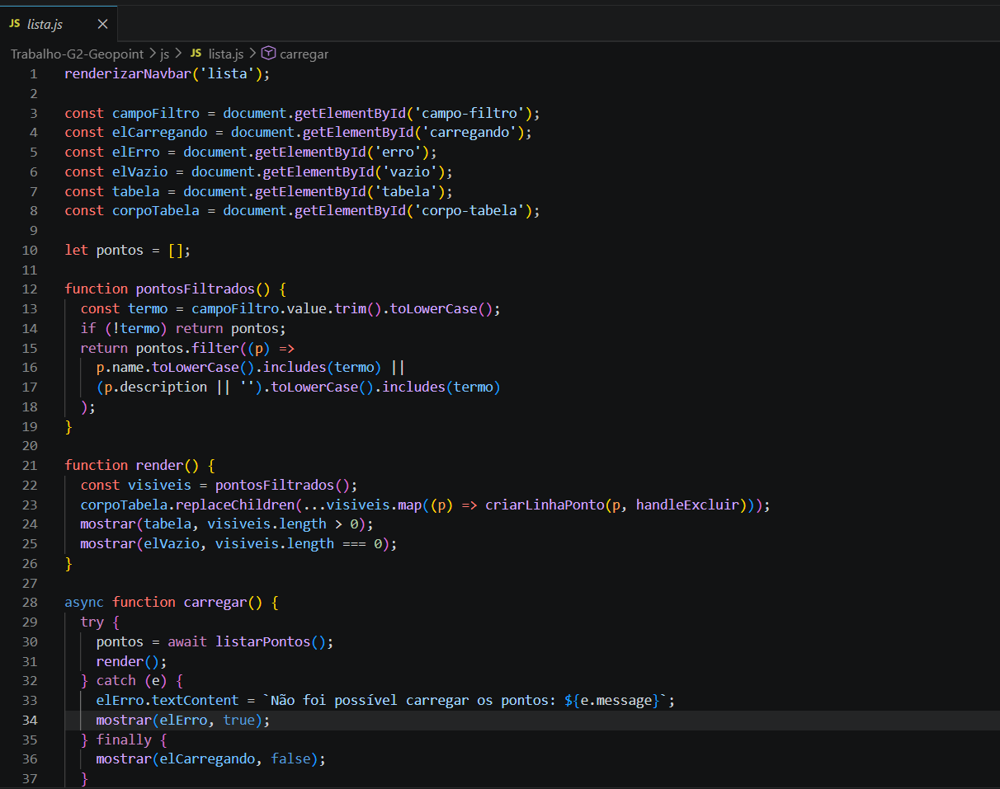
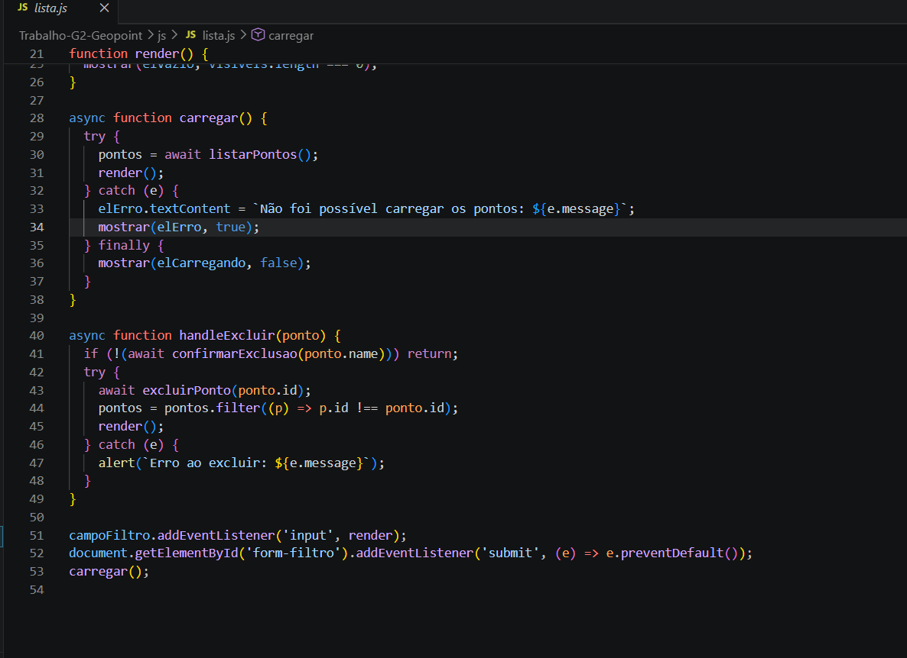
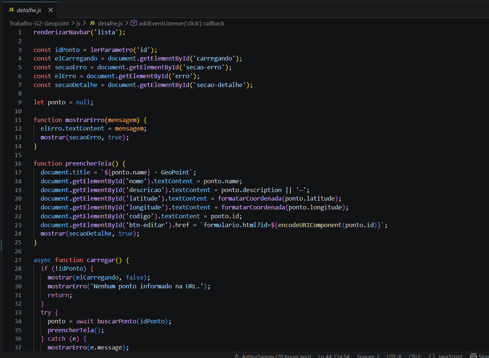
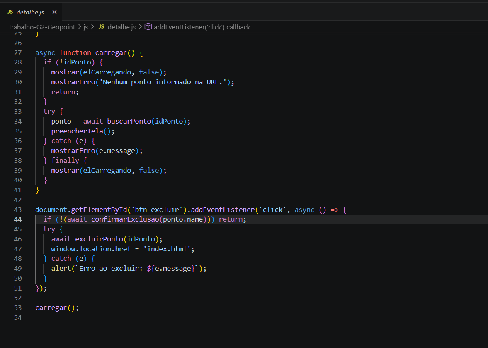
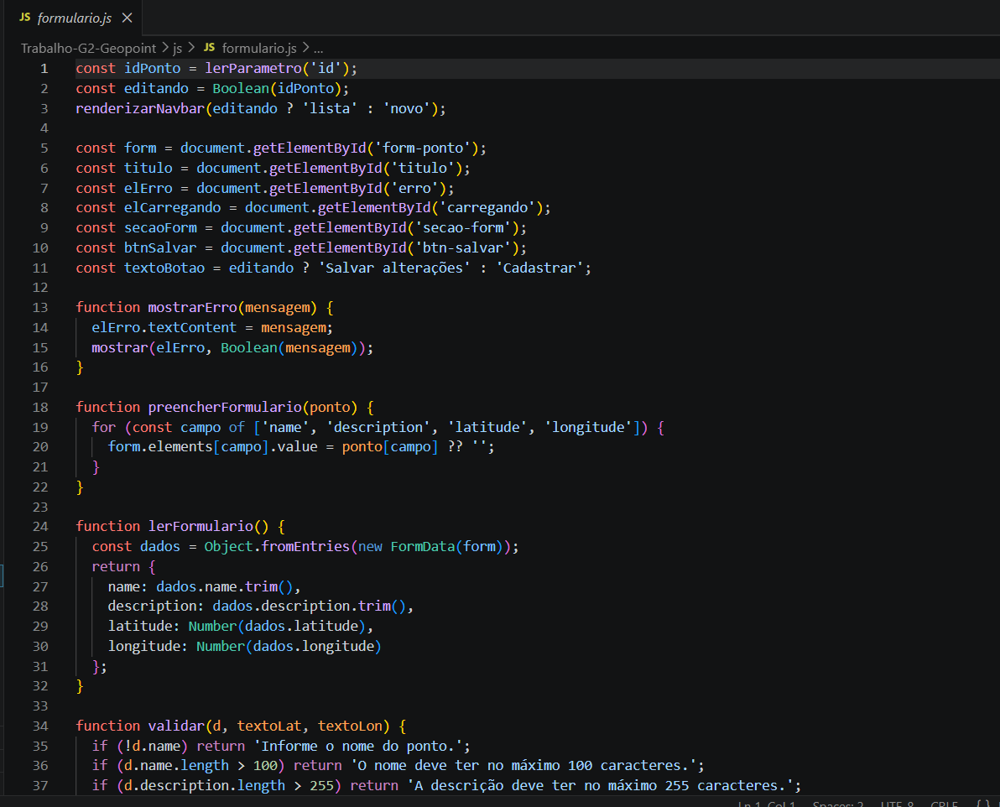
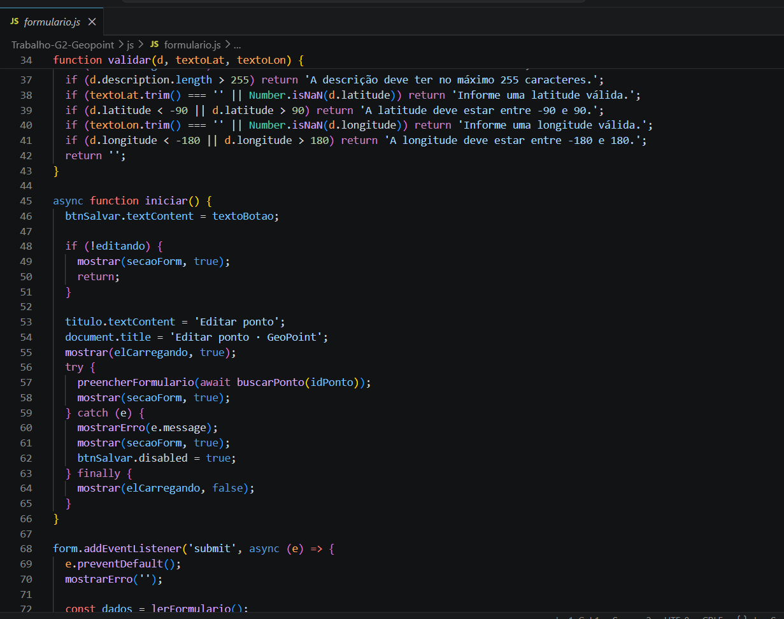
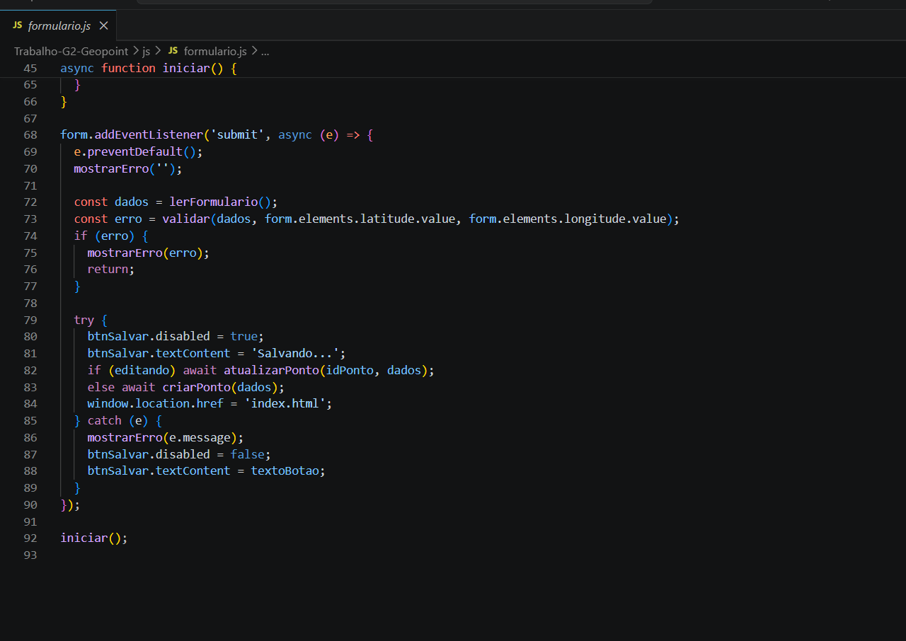

# GeoPoint · CRUD de Pontos Geográficos

Trabalho G2 da disciplina de Desenvolvimento Frontend (Atitus Educação).

## Quem fez

- Arthur Saggin - 1139361
- João Isaque - 1139559

## Sobre o projeto

A ideia foi montar um sistema para cadastrar pontos geográficos (nome, descrição, latitude e longitude). Dá para cadastrar, listar, filtrar, ver os detalhes, editar e excluir cada ponto. O front conversa com uma API que nós mesmos criamos para as duas matérias, então o CRUD funciona de verdade, sem dados fixos no código.

## Tecnologias

- **Front-end:** HTML, CSS e JavaScript puro (opção A do enunciado), sem frameworks e sem instalar nada.
- **API:** Java com Spring Boot, usando Spring Web, Spring Data JPA e Validation.
- **Banco de dados:** H2 em memória. Os pontos ficam guardados enquanto a API está rodando e somem quando ela é reiniciada.

## URL da API

```
http://localhost:8080/api/points
```

O endereço base (`http://localhost:8080`) fica definido em um único lugar, na constante `API_URL` do arquivo `js/api.js`. Se a API rodar em outra porta, é só alterar essa linha.

## Como rodar

A API precisa estar rodando antes de abrir o front.

### 1. Subir a API

Você vai precisar do JDK 17 ou superior e do Maven. Também dá para abrir a pasta `backend` no IntelliJ ou no VS Code (com a extensão de Java) e executar a classe `GeoPointApplication`.

```
cd backend
mvn spring-boot:run
```

Na primeira vez o Maven baixa as dependências, então pode demorar alguns minutos. Quando aparecer `Started GeoPointApplication`, a API está no ar. Para conferir, abra `http://localhost:8080/api/points` no navegador: se aparecer `[]`, está tudo certo (a lista só está vazia).

Deixe esse terminal aberto enquanto estiver usando o sistema.

### 2. Abrir o front

Com a API rodando, abra o arquivo `index.html` no navegador (dois cliques funcionam) ou use a extensão Live Server do VS Code.

## Telas

| Tela | Arquivo | O que faz |
|---|---|---|
| Listagem | `index.html` | Lista os pontos, filtra por nome ou descrição e exclui |
| Cadastro | `formulario.html` | Cadastra um novo ponto (POST) |
| Edição | `formulario.html?id=...` | Carrega o ponto e salva as alterações (PUT) |
| Detalhe | `ponto.html?id=...` | Mostra todos os dados e permite editar ou excluir |

O mesmo formulário serve para cadastrar e editar: se existe `id` na URL, ele carrega o ponto e faz o PUT, senão faz o POST.

## O que a API oferece

| Método | Endereço | Para quê | Retorno |
|---|---|---|---|
| POST | `/api/points` | Cadastrar | 201 |
| GET | `/api/points` | Listar todos | 200 |
| GET | `/api/points/{id}` | Buscar um | 200 |
| PUT | `/api/points/{id}` | Atualizar | 200 |
| DELETE | `/api/points/{id}` | Excluir | 204 |

Regras de validação (feitas no front e também na API):

- `name`: obrigatório, até 100 caracteres
- `description`: opcional, até 255 caracteres
- `latitude`: obrigatória, entre -90 e 90
- `longitude`: obrigatória, entre -180 e 180

Os erros da API voltam no formato `{ "message": "..." }` e aparecem para o usuário na própria tela.

## Como o código está organizado

```
.
├── backend/                 API em Spring Boot
│   └── src/main/java/br/com/geopoint/
│       ├── controller/      endpoints REST
│       ├── service/         regras de negócio
│       ├── repository/      acesso ao banco
│       ├── model/           entidade Point
│       ├── dto/             PointRequest e PointResponse
│       ├── exception/       tratamento de erros
│       └── config/          liberação de CORS
├── css/
│   └── style.css            estilo de todas as telas
├── js/
│   ├── api.js               chamadas à API e funções de apoio
│   ├── componentes.js       funções que montam botões, linhas da tabela, menu e a janela de confirmação
│   ├── lista.js             listagem, filtro e exclusão
│   ├── formulario.js        cadastro e edição
│   └── detalhe.js           tela de detalhe
├── index.html
├── formulario.html
└── ponto.html
```


## Prints das telas

### Listagem




### Detalhe




### Edição




